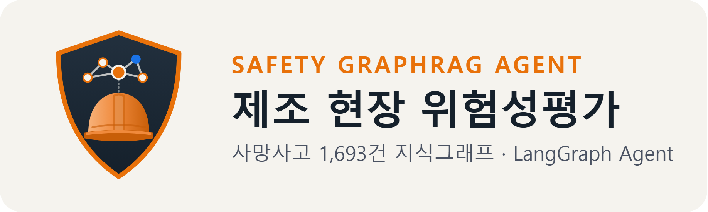

<p align="center"></p>

# 제조 현장 위험성평가 GraphRAG Agent

작업 내용을 말하면, 실제 사망사고 기록을 연결한 지식그래프에서 그 작업의 위험요인을 빠짐없이 찾아 대책과 근거 사고와 함께 알려주는 AI Agent입니다.

온라인 데모: https://safety-graphrag-agent-h3dtsfx8pvgtkxkpmxyq7v.streamlit.app/ (API 키 없이 예시 질문 재생, 목록 조회)

## 배경
제조, 물류 현장에서는 정비, 청소, 운반 같은 작업 전에 위험성평가와 작업 전 회의(TBM)로 위험을 미리 점검합니다.
이때 경험과 기억에 기대면 자주 본 위험은 떠올리지만, 드물게 일어난 위험은 놓치기 쉽습니다.

## 문제
- 한국산업안전보건공단 사망사고 데이터를 보면, 작업이나 설비별로 알아야 할 위험요인 3개 중 2개는 사망사고가 1~2건뿐인 드문 위험입니다.
- 흔히 쓰는 AI 검색(벡터 RAG)은 질문과 비슷한 기록 몇 건만 골라 읽기 때문에, 이런 드문 위험을 놓칩니다.
- 현장 안전에서는 위험 하나만 빠져도 치명적이므로, 비슷한 몇 건이 아니라 해당하는 위험 전부가 필요합니다.

## 소개
- 공공데이터 사망사고 1,693건(제조업, 운수창고업)으로 사고, 설비, 작업, 위험요인, 대책을 잇는 지식그래프를 만들었습니다.
- LangGraph Agent가 현장 말투의 질문을 설비와 작업으로 이해하고, 그래프에서 연결된 위험요인을 전부 찾습니다. 결과가 없으면 범위를 넓혀 다시 찾고, 설비나 작업이 빠진 질문에는 무엇을 더 알려 달라고 되묻습니다.
- 위험 판단은 그래프 조회가 하고, AI(gpt-5-mini)는 질문 이해와 현장 설명에만 씁니다. 설명에 붙은 근거 번호가 실제 대책과 사고 기록인지 코드로 검사합니다.
- 다른 시스템이 부를 수 있는 API(FastAPI)와 챗봇 데모(Streamlit)를 제공합니다.

## 폴더 구조
```
safety-graphrag-agent/
├── app.py                  Streamlit 데모 (질문하기, 목록으로 조회)
├── api.py                  FastAPI 서버 (POST /assess, GET /health)
├── collect.py              공공데이터 API에서 사고 기록 수집
├── src/
│   ├── graph.py            사고 기록으로 지식그래프 만들기 (메모리)
│   ├── load_neo4j.py       로컬 Neo4j 적재와 Cypher 조회
│   ├── agent.py            LangGraph Agent 전체 흐름
│   ├── query_parser.py     질문 이해, 설비와 작업 이름 맞추기
│   ├── answer.py           상세 설명할 위험 고르기, 근거 검증, 답변 만들기
│   ├── vector_rag.py       비교용 벡터, 키워드 검색과 임베딩 캐시
│   ├── llm.py, settings.py OpenAI 호출, .env 설정 읽기
│   ├── build_node_index.py 세부 설비 이름 임베딩 캐시 만들기
│   ├── make_*.py           평가 질문, 데모 기록 만들기 (실제 키 사용)
│   └── eval_*.py           평가 실행 (결과 보고서는 docs/eval/에 생성, git 제외)
├── data/
│   ├── raw/sif.json        수집 원본
│   ├── eval/               평가 질문과 실행 결과
│   └── demo/records.json   데모에서 재생하는 실행 기록
├── tests/                  API 키와 외부 네트워크 없이 도는 테스트
├── assets/                 엠블럼 이미지
├── Dockerfile, docker-compose.yml
└── requirements.txt, .env.example
```

## 실행
```bash
docker compose up                      # 데모만: http://localhost:8501 (Python, 키 불필요)

pip install -r requirements.txt        # 개발 환경 (Python 3.14)
python -m pytest -q                    # 키 없이 테스트
cp .env.example .env                   # 키 입력 (git 제외)
docker compose --profile neo4j up -d   # 선택: 로컬 Neo4j
```

데이터: 한국산업안전보건공단 사망사고 고위험요인(SIF) 아카이브 (공공데이터포털, 이용허락범위 제한 없음).
사업장 위험성평가와 법정 안전조치를 대신하지 않는 참고 자료입니다.
